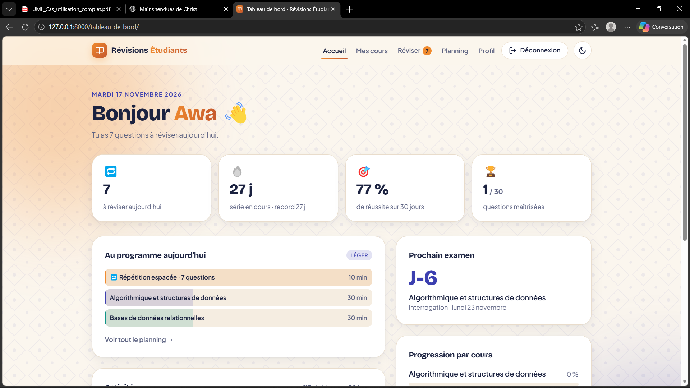
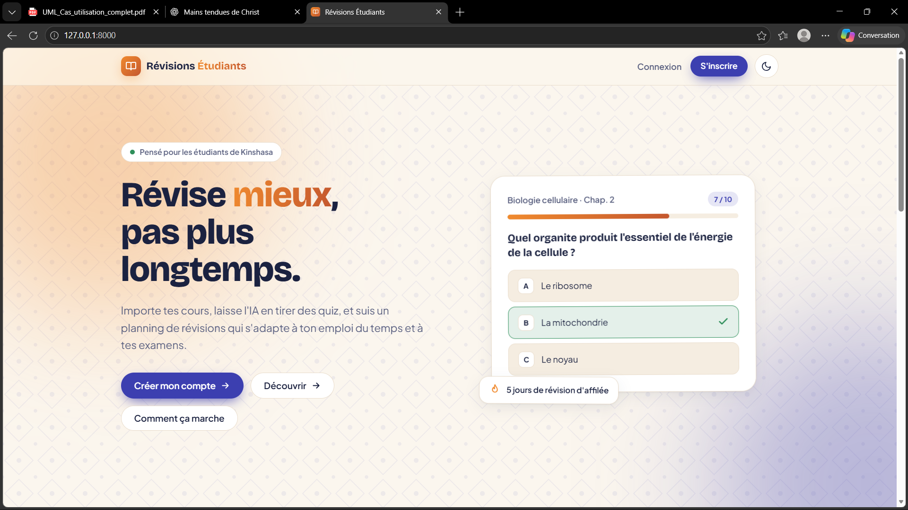
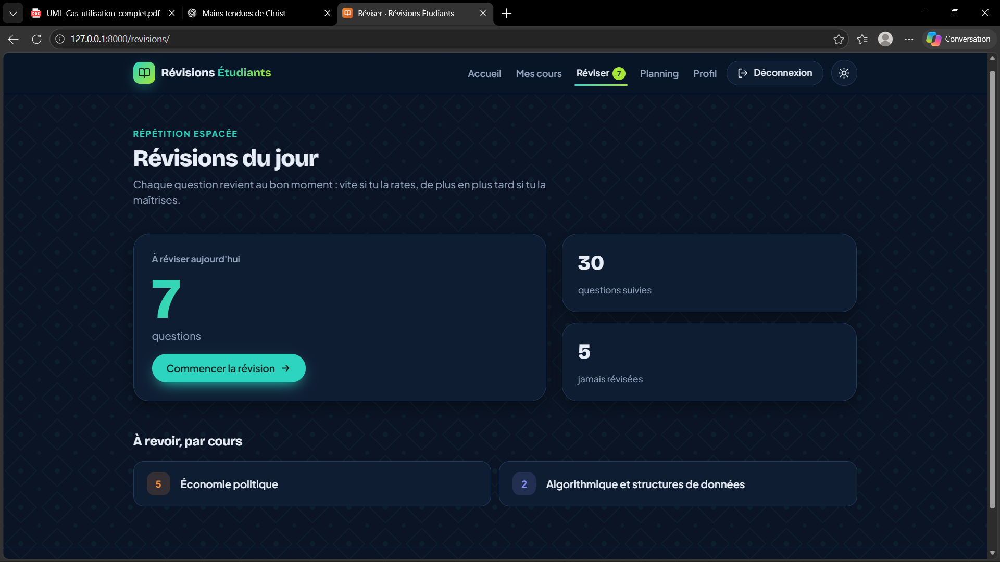
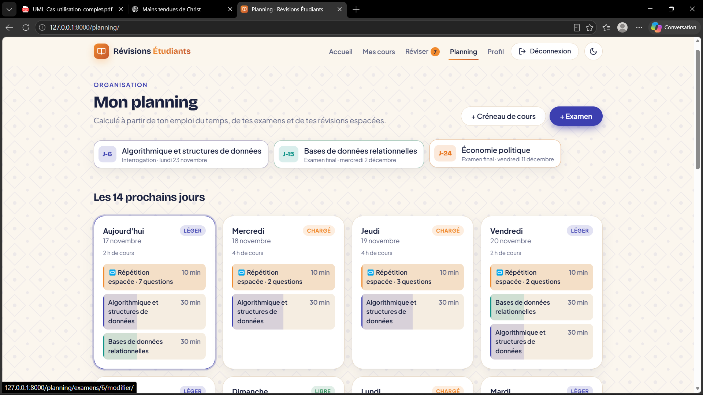
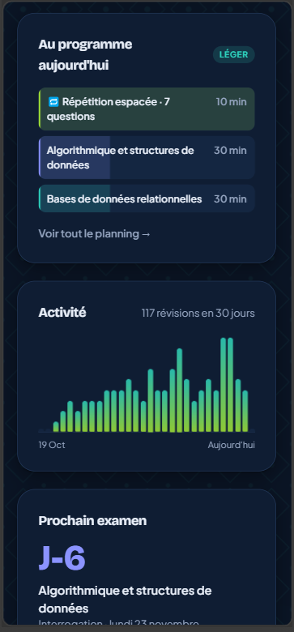
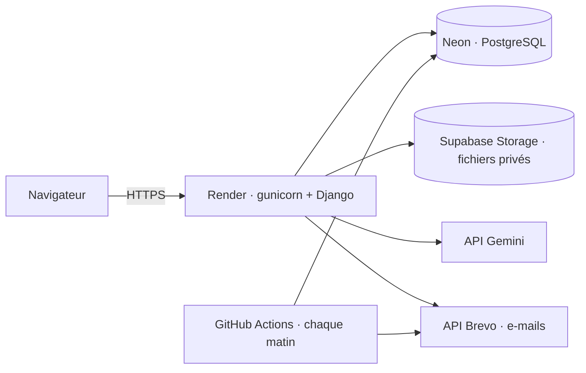

# 📚 Révisions Étudiants

[](https://github.com/milliardongumbi18/revisions-etudiants/actions/workflows/tests.yml)


**Application web d'aide aux révisions pour les étudiants**, pensée pour les universités de Kinshasa (RDC) :
quiz générés par IA à partir de ses propres cours, répétition espacée et planning de révisions adapté à son emploi du temps.

🔗 **Démo en ligne : https://revisions-etudiants.onrender.com**
Compte de démonstration : **`demo`** / **`Demo-Kinshasa-2026`** (remis à neuf à chaque déploiement)

> Hébergement gratuit : la première visite peut prendre ~1 minute (réveil du serveur).



## ✨ Fonctionnalités

- **Cours et chapitres** : notes saisies ou dictées à la voix, import de PDF/.txt ; un PDF de cours complet est découpé automatiquement en chapitres grâce à ses signets.
- **Quiz générés par IA** (Gemini) : QCM et questions courtes avec explications, sans répéter les questions déjà posées.
- **Répétition espacée (SM-2)** : les questions ratées reviennent vite, les questions maîtrisées s'espacent (1 jour, 6 jours, puis de plus en plus).
- **Planning de révisions** : à partir de l'emploi du temps et des dates d'examens, un plan sur 14 jours qui charge moins les jours de cours et priorise les examens proches.
- **Tableau de bord** : série de jours révisés, activité sur 30 jours, taux de réussite, progression par cours.
- **Rappels quotidiens par e-mail** (sur consentement) quand des révisions attendent, avec lien de désinscription.
- **Compte** : mot de passe oublié par e-mail, photo de profil, suppression du compte et de toutes ses données.
- **Interface soignée** : thème clair « Encre & Mangue » et thème sombre « Fleuve de nuit », animations respectant `prefers-reduced-motion`, responsive mobile.

| Accueil | Séance de révision |
|---|---|
|  |  |

| Planning | Mobile |
|---|---|
|  |  |

## 🏗️ Architecture



```
accounts/    comptes (utilisateur personnalisé, connexion protégée, mot de passe oublié, photo, suppression)
courses/     cours et chapitres (fichiers, import découpé par signets)
quizzes/     quiz et questions générés
reviews/     cartes de révision SM-2, séances, historique, rappels quotidiens
planning/    créneaux de cours, examens, plan de révisions
dashboard/   statistiques et progression
services/    logique métier en fonctions pures, testables sans Django :
             sm2.py · planner.py · stats.py · documents.py · images.py · quiz_generator.py · ai_provider.py
```

**Choix notables**
- **Couche d'abstraction IA** (`services/ai_provider.py`) : changer de fournisseur (Gemini → Groq…) = une classe et une variable d'environnement. Un fournisseur factice permet de tester sans réseau ; les erreurs passagères (503) sont retentées automatiquement.
- **Sortie JSON imposée par schéma** à l'IA, puis validée côté serveur avant d'être enregistrée.
- **Algorithmes isolés** (SM-2, planification, séries de jours) dans des fonctions pures, faciles à tester et à expliquer.
- **Planning calculé à la volée** plutôt que stocké : toujours à jour quand l'emploi du temps ou les examens changent.
- **E-mails par API HTTPS** (moteur d'envoi Django maison pour Brevo) : l'hébergeur gratuit bloque le SMTP.

## 🔒 Sécurité

| Risque | Protection |
|---|---|
| Accès aux données d'un autre étudiant (IDOR) | Toutes les requêtes filtrées par propriétaire → 404 ; le propriétaire n'est jamais un champ de formulaire |
| XSS | Échappement automatique des templates + **Content Security Policy** stricte (scripts autorisés par nonce) |
| CSRF | Jeton sur tous les formulaires ; aucune action sur un simple GET (déconnexion, désinscription) |
| Force brute | Blocage de 15 min après 5 échecs de connexion, message identique que le compte existe ou non |
| Fichiers malveillants | PDF : taille, signature `%PDF-`, chiffrés refusés. Images : vrai format vérifié par Pillow, limite de pixels, ré-encodage en WebP (métadonnées GPS supprimées). Noms régénérés, bucket privé, liens signés 10 min |
| Mot de passe oublié | Lien signé valable 1 h et à usage unique, aucune fuite sur l'existence d'un compte, 1 e-mail / 5 min par adresse |
| Injection SQL | ORM Django (requêtes paramétrées) |
| Injection de consigne (IA) | Le cours est transmis comme donnée, la consigne interdit d'en suivre les instructions |
| Secrets | Variables d'environnement uniquement (`django-environ`), jamais dans le dépôt |
| Transport | HTTPS forcé, HSTS 1 an, cookies `Secure`/`HttpOnly` |
| Vie privée | Rappels sur consentement explicite, suppression du compte et de toutes ses données par l'utilisateur |

## 🧪 Tests et intégration continue

**127 tests** (modèles, vues, permissions, algorithmes, IA et e-mails simulés, images). GitHub Actions vérifie à chaque Pull Request la configuration, les migrations oubliées et l'ensemble des tests, et envoie les rappels chaque matin.

```powershell
python manage.py test
```

## 🚀 Lancer le projet en local (Windows)

```powershell
git clone https://github.com/milliardongumbi18/revisions-etudiants.git
cd revisions-etudiants
python -m venv .venv
.venv\Scripts\Activate.ps1
python -m pip install -r requirements.txt
Copy-Item .env.example .env          # puis renseigner SECRET_KEY (AI_PROVIDER=fake pour se passer de clé)
python manage.py migrate
python manage.py creer_demo --mot-de-passe "Demo-Kinshasa-2026"

# CSS : Tailwind autonome, sans Node.js
Invoke-WebRequest -Uri "https://github.com/tailwindlabs/tailwindcss/releases/download/v4.3.1/tailwindcss-windows-x64.exe" -OutFile tailwindcss.exe
.\tailwindcss.exe -i static\src\tailwind.css -o static\css\tailwind.css --watch   # terminal 1
python manage.py runserver                                                        # terminal 2
```

En local, les e-mails (mot de passe oublié, rappels) s'affichent dans le terminal.

### Variables d'environnement

| Variable | Rôle |
|---|---|
| `SECRET_KEY` | Clé secrète Django (obligatoire) |
| `DEBUG` | `True` en local, `False` en production |
| `DATABASE_URL` | PostgreSQL en production (SQLite sinon) |
| `AI_PROVIDER` | `gemini` (défaut) ou `fake` |
| `GEMINI_API_KEY`, `GEMINI_MODEL` | Accès à l'API Gemini |
| `STORAGE_BUCKET`, `STORAGE_ENDPOINT`, `STORAGE_REGION`, `STORAGE_ACCESS_KEY`, `STORAGE_SECRET_KEY` | Stockage objet S3 (Supabase) |
| `EMAIL_BACKEND`, `BREVO_API_KEY`, `DEFAULT_FROM_EMAIL` | Envoi des e-mails par l'API Brevo |
| `SITE_URL` | Adresse publique du site (liens des e-mails de rappel) |
| `DEMO_PASSWORD` | Active la réinitialisation du compte de démo au déploiement |

## 🛠️ Stack

Python 3.14 · Django 6.1 · PostgreSQL (Neon) · Tailwind CSS 4 (CLI autonome) · JavaScript natif · pypdf · Pillow · API Gemini · API Brevo · Supabase Storage (S3) · WhiteNoise · gunicorn · Render · GitHub Actions

## 🧭 Pistes d'amélioration

Génération des quiz en tâche de fond, nom de domaine dédié pour les e-mails, import .docx, OCR des cours scannés, notifications sur téléphone.

---

Réalisé par [@milliardongumbi18](https://github.com/milliardongumbi18).
